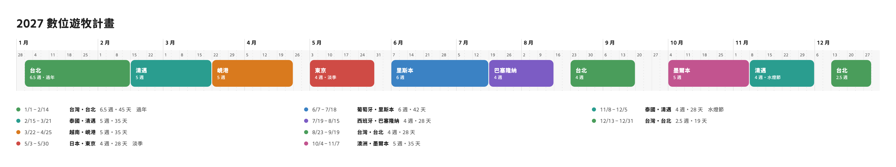
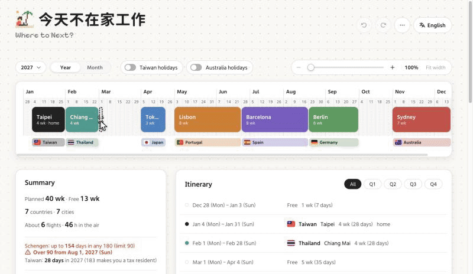
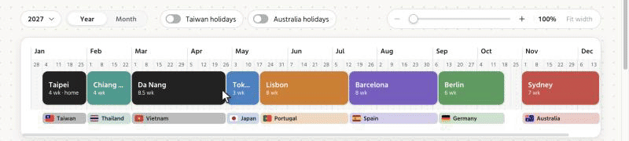
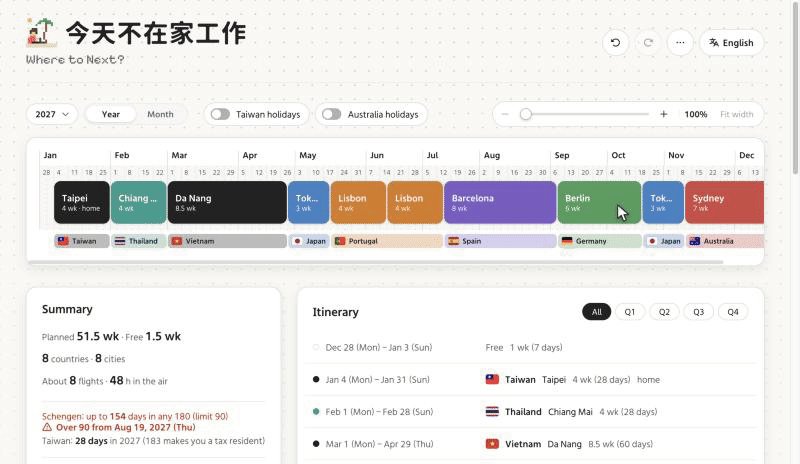
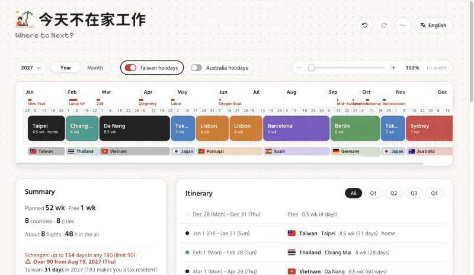

# Not WFH

**A Digital Nomad Planner** — 今天不在家工作 in Chinese, 今日は在宅じゃない in Japanese: the same joke in three languages. The interface shows whichever name matches its language.

[繁體中文](README.md) · **English**

A single-page planner for a year of digital nomading. The year is laid out as 53 weeks; drag across them to block out which city you'll be in and when. It works without an account, with your data in your browser; sign in with Google only if you want your phone and computer to see the same plan.

**Live: <https://simonlin7972.github.io/digital-nomad-planner/app/>** (landing page: <https://simonlin7972.github.io/digital-nomad-planner/>)



The interface is available in Traditional Chinese, English and Japanese; choose on the settings page.

---

## Contents

- [Features](#features)
- [Getting started](#getting-started)
- [Controls](#controls)
- [Data and privacy](#data-and-privacy)
- [Data format](#data-format)
- [Project structure](#project-structure)
- [Design notes](#design-notes)
- [Known limits](#known-limits)
- [Possible next steps](#possible-next-steps)
- [Third-party resources](#third-party-resources)
- [Contributing](#contributing)
- [License](#license)

---

## Features

### Year view (timeline)

- One horizontal timeline of a whole year (53 weeks in 2027), one cell per week, each split into two half-weeks; zoomed to 300% or more it works by the day
- Drag across empty cells → enter a country and city → a stay appears
- Dragging a whole stay **reorders** it: once it is halfway past a neighbour the two swap, and so on down the line
- Dragging a stay's edge **resizes and pushes**: growing shoves neighbours along, using up gaps first
- Holding `Alt` (`⌥` on a Mac) while dragging **duplicates**: the original stays put and a copy is inserted where you let go and the stays after it shift later (nothing before it moves)
- Holding `B` and clicking a stay **cuts** it: the pointer turns to scissors with a line showing the cut, and a click splits the stay in two there (the second part has no flight)
- A strip under each stay shows its country (flag and name); back-to-back stays in the same country share one strip
- Zoom from 100% to 600% with the slider, a trackpad pinch, two-finger touch, or `Ctrl`/`Alt` + wheel, always centred on the pointer
- Drag the month row to pan; click a month to open it in the month view





### Month view (calendar)

- A seven-column calendar, precise to the **day**
- Drag across days to add a stay; drag a bar's ends to change its dates; click a bar to edit it; hold `B` and click a bar to cut it in two
- The header shows how many days of the month are planned and free
- The "All months" switch beside the tabs stacks January to December down one long page to scroll through; every month can still be dragged and edited; once scrolled down, a button in the bottom-right corner goes back to the top



### What a stay records

- Country and city (at least one). Both are picked from searchable lists, in any of the three languages; while a field with something in it has focus, an × at its end clears it and shows the whole list (the airline and flight number fields too):
  - Countries: about 260, also searchable by ISO code or common alias (`thai`, `jp`, `韓國`); the full list comes in three sections, "Popular" (used here and common ones), "All" and "Regions"
  - Cities: about 330 common ones built in. With a country chosen only its cities are listed; with none, the list has "Popular" (used here and the popular nomad bases: Chiang Mai, Bangkok, Lisbon, Canggu…) and "All", and picking a city fills the country in. Cities not on the list can simply be typed
  - The matching letters are bold in the results; a one-letter typo still finds the name (`tailand`, `bankok`); when nothing matches, the list has one row, "Use “what you typed”", and clicking it or pressing Enter saves it as typed
- Exact start and end dates
- Color (black plus 8 others; a new place starts black, a place you've used before keeps its color)
- Who you're travelling with
- Flight booked: airline, flight number, departure time, booking reference, fare, and optionally the **return** leg's airline, flight number and departure (the airline starts as the outbound one and is stored only when changed; booking reference and fare are shared). When the return departure date and the stay's last day differ, the editor says so and can move the stay's end to that date in one click; the hover card shows the return departure. A stay with this switched on is **locked** on the timeline and calendar (it shows a small padlock): it can't be dragged, stretched or cut, and neighbouring stays can't push it; its dates change only in the editor. The airline is picked from a searchable list of about 75 common airlines, each with its logo (by Chinese or English name or two-letter code, or typed freely); the flight number picker offers that airline's code and flight numbers already in the plan. When the departure date and the stay's first day differ, the editor says so and can move the stay's start to the departure date in one click; a stay's hover card shows the departure time
- A note

### Overview

- **Summary**: weeks planned and free, countries and cities visited, an estimate of flights and hours in the air, and weeks and days per country and city
- **Days of stay**: the summary works out the most days spent in the Schengen area within any 180 days (the limit is 90; when exceeded it says from which date), and the days planned in your tax-residence country that year (Taiwan unless changed in settings; 183 days is the usual tax-residency line). The Schengen count looks back into the previous year's plan; unplanned days don't count
- **Visas**: with a passport set on the settings page, each destination shows what entry takes on that passport (visa-free for how many days, visa on arrival, an ETA / e-visa / visa needed first) in the editor, the stay's hover card and the phone cards; back-to-back stays in one country that run past the visa-free days get a warning on the timeline and in the itinerary; the summary lists the countries that need something arranged first. Schengen countries are left to the 90/180 count. The data is the open-source passport-index-data (2026-02-17), loaded only once a passport is set (about 14 kB); official rules take precedence. With no passport set nothing shows
- **Long-stay options**: under the visa line the editor has "Long-stay options (N)", which opens the country's digital nomad visas and similar programs (name, how long, main thresholds and fees, a link to the official page), 28 in all: Thailand's DTV, Malaysia's DE Rantau, Indonesia's E33G, Japan, Korea, Taiwan's Gold Card and nomad visa, Sri Lanka, the UAE, Portugal's D8, Spain, Italy, Greece, Croatia, Estonia, Hungary's White Card, Malta, Cyprus, Germany's freelance permit, Türkiye, Mexico, Colombia, Brazil, Argentina, Costa Rica, Panama, Uruguay and Ecuador. Also shown only with a passport set, and left out where the passport already moves freely (an EU passport in the EU) or doesn't qualify (Türkiye's list of nationalities). Compiled by hand (2026-10); official sources take precedence
- **Itinerary**: one line per stay — dates, flag and country, city, weeks (days), companions, note; filter by Q1–Q4; stays with a flight show a ticket icon; stays that overrun the Schengen limit show a warning icon
- **Seasons**: about 71 popular nomad bases (Chiang Mai, Bali, Lisbon, Mexico City…) carry a best / fine / avoid rating for each month, with reasons. The editor has a "When to go" button that opens the twelve months and reasons (it flags a poor season even when closed); stays that land in months to avoid (Chiang Mai's burning season in March–April, Dubai's summer) get a warning on the block, in the itinerary and on the hover card
- **Free stretches**: unplanned days between stays are listed in the itinerary too; press `+` to add a stay in that gap
- **Map**: every place in visit order, joined into a route
- **Year**: the drop-down beside the view tabs switches between 2025, 2026, 2027 and 2028; each year keeps its own plan. Dragging the month row past December (or January) and letting go moves to the next (or previous) year. A stay can cross into the next year: it is kept in the year it starts in and its end date can fall in the next year (chosen in the editor), shown with "2028 →" at the end of the timeline; the next year's timeline opens with a faded, striped copy marked "From 2027", which takes you back to that year when clicked, and the two years' stays never overlap
- **Travel days**: the day you leave one place and arrive in the next can belong to both stays: start the next stay on the day the last one ends, or drag a stay's end onto its neighbour's first (or last) day. The calendar splits that day in half with a small plane between the two bars, and the timeline blocks meet in the middle of it (with no plane); the list, the phone cards and the editor mark it "Travel day". Two stays can share only that one day (and each must be longer than it). Schengen and tax-residence counts include it for both places; totals count it once
- **Public holidays**: the "Holidays" button in the view bar opens a menu with a switch per set, drawn over the timeline and calendar; dots on the button show which sets are on. Taiwan and Australia are always there (hand-compiled for 2026 and 2027); every other country in the plan gets its own "… holidays" row, off by default, in the colour of that country's first stay, for any year. Those come from the open-source date-holidays package, loaded the first time one is needed (about 240 kB), public holidays only, named in English except for Taiwan and Japan



### Also

- **Google sign-in and cloud sync (optional)**: signed in, your plan and settings are also kept in the cloud so your phone and computer see the same one; a change goes up 1.5 s later, and the cloud is read again on load, on returning to the tab and when another device writes. Signed out, nothing changes. Find it in the `⋯` menu, on the backup reminder, on the phone's empty page and in the settings page's "Account" section. The first sign-in on a device that finds a different plan on each side asks which to keep (choosing the cloud's first exports this device's plan as JSON). The settings page can sign out (this device only; its data stays) or delete the cloud data (and sign out every device)
- A built-in "How to use" guide in sections that open and close: gestures, where data lives, backup and transfer
- Traditional Chinese, English and Japanese interface, chosen on the settings page (the landing, cities and changelog pages can switch it from their headers too); defaults to the browser's language and remembers your choice
- A compact toolbar: undo and redo are icons, shown only once there is a change to undo or redo; export, import and Share live in the `⋯` menu, with "How to use", "About this app" (opens the landing page in a new tab) and "Report a problem or suggest" (a title, a description, up to 3 screenshots and an optional email, sent straight to the developer) below a divider
- A footer at the bottom of the page: where the data lives, the licence, and links home, to the cities page and to the changelog
- A changelog page (/changelog/): new features and changes in every release, newest day first, in the interface language (English when the interface is Japanese). It is built from `CHANGELOG.md` at the repository root, so updating that file and pushing publishes it
- A "Ten cities for digital nomads" page (/cities/, linked from the landing page's nav and footer and the planner's footer): Chiang Mai, Lisbon, Bangkok, Canggu, Da Nang, Kuala Lumpur, Taipei, Tokyo, Tbilisi and Mexico City. Ten cards on top (a one-line take, one-bedroom rent, monthly cost for one, fixed broadband, a twelve-month best-months strip and a visa line), then an article per city below (upsides, downsides, 300–500 characters, the visa line and sources), each card linking to its anchor (such as `/cities/#lisbon`), written separately in all three languages. The data is hand-compiled in `src/lib/nomadCities.ts`, nothing is scraped, and every city lists where its numbers came from; figures are rough (US dollars a month, checked in October 2026) and visa lines assume a Taiwan passport; best months come straight from the season data. The page reads neither the plan nor the settings
- A Profile & settings page (/profile/, from the person icon at the right end of the toolbar; once a character is saved, the button shows its face):
  - My character: a front-facing pixel paper doll. Pick one of 10 ready-made nomads (engineer, designer, surfer, backpacker…) or put one together from skin tone, hair, top, bottom and shoes, plus separate slots for the head, eyes, mouth and cheeks, neck, back, each hand and each side (hats, a conical hat, bunny ears, glasses, an eye patch, a beard, a face mask, a scarf, a neck pillow, bags, a guitar, a skateboard, a cape, bubble tea, an umbrella, a suitcase, a surfboard, a tent, a cat, dog or rabbit…); or roll a random one; clothes and extras take a custom colour from a 35-colour palette or a hex code as well as the built-in swatches. Pointing at a choice previews it; this one is saved with its own Save button, and leaving without saving drops the changes. Once saved, it appears on the toolbar's settings button and on the shared image, the large figure can turn around to show its back, and hovering it offers it as a 256×256 transparent PNG
  - About me: a nickname (shown on the shared image), home (the flight estimate adds the trips from and back home), passport (an EU, EEA or Swiss passport hides the Schengen 90/180 count) and tax residence (the country whose 183 days are counted; Taiwan by default, empty to hide)
  - Display: language, public holiday switches, temperature unit (°C / °F)
  - Data: how long before the backup reminder (3 / 7 / 14 days, or off)
  - About: the last update date and links home and to the changelog
  - Everything but the character saves at once; it all stays in this browser and is not part of exports
- Undo and redo, up to 100 steps
- JSON export and import: one file holds every year; file names carry the export date (e.g. `nomad-plan_2026-10-06.json`). On a computer you can also drop the file onto the page to import it
- Send to another device: the `⋯` menu makes a link and a QR code carrying every year's plan; opening it on another computer or phone imports it there (asking first before replacing years already planned), and pasting it into a tab that already has the planner open works too. The plan is compressed into the part of the address after `#` and never passes through a server; booking references and fares can be left out
- Share: preview your plan as an image, then download it as a PNG, in two layouts — landscape (fixed size, with the timeline, country strips and flags, holidays that are switched on, ticket markers, a summary line and the itinerary) and portrait 9:16 (for stories: summary, twelve month bars and the itinerary, ending in "N more" when it runs out of room); a saved character is drawn to the right of the title; flight details left out of both. Landscape is the default on a computer, portrait on a phone, where it can also open the system share sheet
- Read-only phone layout: below 720px (or on a phone held sideways) the page becomes view-only — a one-row header; at the top, "now" (dates, progress, days left) and "next" (days until you leave, with the flight right there if you have one), found across years; below, one card per stay (flight details and full notes included), with past stays folded into one line you can open; then the summary and the map. It opens on the current year. Stay cards let you copy the flight number and booking reference, add the departure to your calendar (.ics), and open the place in Google Maps. Menus and dialogs rise from the bottom of the screen, and the guide shows only the parts that apply on a phone. Plan on a computer, then use "Send to another device" and scan the QR code, or export a file and import it on the phone
- Installable and usable offline: a service worker keeps the files and fonts the page has loaded, so it opens without a connection (the map aside)
- Every change is saved automatically
- Backup reminder: when the plan has changed and gone 7 days without an export, a reminder appears under the header, with buttons to export or to put it off for 3 days
- Every page's header sticks to the top: scroll down and it folds in place into a floating frosted pill, and opens back up at the top. The planner's shrinks its title and folds the tagline away, keeping the toolbar; on a phone the planner's one-row header neither sticks nor folds
- Landing page (the site root; the app is at `/app/`): it looks like the app itself (dot-grid paper, ink, white panels, colour only from the stays, flags and pixel art); each section's label is drawn as a stay, and a year-of-stays bar across the top fills as you scroll. The demos are **the real components** on a sample plan, and you can use them: the timeline (drag to add, reorder, stretch and push, hold `B` to cut, `Alt` to copy, click a month for the calendar), the month view, the editor, the summary and itinerary, the map, the phone layout and the share preview, all linked. The sample lives only in that page's memory: a reload resets it, it never reads or writes your plan, looks up no coordinates and sends no analytics for share downloads; once changed, a "Reset the sample" button appears. On a phone the try-it area shows the phone layout instead. There are also Schengen / 183-day / season questions, the pixel characters, the ten cities (each with a twelve-month season strip), what is kept where, an FAQ, in all three languages. The nav bar sticks to the top: flat and transparent at the top of the page, it folds into a floating, frosted pill once you scroll down

---

## Getting started

Requires Node.js 22 or later.

```bash
git clone https://github.com/Simonlin7972/digital-nomad-planner.git
cd digital-nomad-planner
npm install
npm run dev
```

Open http://localhost:5173/app/ (the root, http://localhost:5173, is the landing page).

| Command | What it does |
| --- | --- |
| `npm run dev` | Start the dev server (fixed to port 5173) |
| `npm run build` | Type-check, then bundle into `dist/` |
| `npm run preview` | Serve the built bundle locally |

The build is plain static files and can be hosted anywhere. Asset paths are relative (`base: './'` in `vite.config.ts`), so it also works from a sub-path.

There are no automated tests and no linter. The `tsc --noEmit` inside `npm run build` is the only check.

### Deploying

Pushing to `main` builds and publishes to GitHub Pages through GitHub Actions (`.github/workflows/deploy.yml`). To deploy a fork, go to the repository's Settings → Pages and set Source to **GitHub Actions**.

The root is the landing page and the app lives at `/app/`; each page's `og:url` holds its own absolute GitHub Pages address. Bookmarks of the old address (the root) now land on the landing page first; plans are in `localStorage` for the whole domain, so moving to `/app/` keeps them.

The live site and a local copy use separate browser storage (different addresses), so they don't share data. Use export and import to move a plan between them.

---

## Controls

### Mouse and touch

| Action | Year view | Month view |
| --- | --- | --- |
| Drag across empty space | Select in half-weeks (in days at 300% zoom and above); add a stay | Select in days; add a stay |
| Click a stay | Open the editor | Open the editor |
| Drag a stay | Reorder | — (not supported) |
| `Alt` + drag a stay | Drop a copy where you let go | — (not supported) |
| Hold `B` + click a stay | Cut it in two at the line | Cut it in two at the line |
| Drag a stay's edge | Resize, pushing neighbours | Resize, pushing neighbours |
| Hover a stay | Show its details | Show its details |
| Click a row in the itinerary | Scroll to that stay and ring it | Open the month it starts in and ring it |
| Drag the month row | Pan the timeline | — |
| Drag the month row past the start or end of the year and let go | Move to the previous or next year | — |
| Click a month | Open that month | — |
| Pinch / `Ctrl`+wheel / `Alt`+wheel | Zoom the timeline | — |

### Keyboard

| Shortcut | Action |
| --- | --- |
| `⌘Z` / `Ctrl+Z` | Undo |
| `⌘⇧Z` / `Ctrl+Shift+Z` / `Ctrl+Y` | Redo |
| `Esc` | Close the editor |
| `Enter` (in the editor) | Save |

Undo and redo shortcuts are left alone while you are typing in a field, while the editor is open, or mid-drag.

While `B` or `Alt` is held, a small label in the view's corner says what a click or drag will do now; it goes when you let go. A stay that just changed (edited, dropped, cut, undone, imported) flashes a ring, so you can see where the change landed.

---

## Data and privacy

**Your plan is never uploaded to a server.** Everything is kept in the browser's `localStorage`:

| Key | Contents |
| --- | --- |
| `dnp-plan-2026`, `dnp-plan-2027`, `dnp-plan-2028` | The plan for each year |
| `dnp-year` | The year being planned |
| `dnp-profile` | The settings page's character, "about me", temperature unit and backup reminder interval |
| `dnp-sync` | Signed in: per year, the plan's fingerprint and the cloud row's updated time as of the last sync, the same for the settings, and whether the sync is paused; cleared on sign-out |
| `sb-qdjungqzeovpdnrijyls-auth-token` | Signed in: the Supabase session (managed by supabase-js) |
| `dnp-geocode` | Cached coordinates for place names |
| `dnp-zoom` | Timeline zoom level |
| `dnp-view` | Current view (year or month) and month |
| `dnp-holidays` | Which holiday sets are on |
| `dnp-lang` | Interface language |
| `dnp-ga-activated`, `dnp-ga-internal` | Analytics only: whether the "first stay created" event has been sent; whether this browser is marked as the owner's (`?internal=1` in the address) |
| `dnp-backup`, `dnp-backup-<year>` | Time of the last export (or import) and a fingerprint of the plan, used to decide when to show the backup reminder; 2027 uses `dnp-backup`, other years one each |

Clearing browser data, or using a different browser or computer, means the plan won't be there. Use Export (in the `⋯` menu) to keep a backup.

The page talks to these outside services:

| Service | What is sent | Why |
| --- | --- | --- |
| [Nominatim](https://nominatim.openstreetmap.org/) (OpenStreetMap) | The "city, country" text for each place | To find coordinates for the map and the flight estimate. Each place is looked up once |
| [OpenFreeMap](https://openfreemap.org/) | Map tile requests | The base map (the planner, and the landing page once its map scrolls near) |
| [emfont](https://font.emtech.cc/) | Font file requests | The Chinese interface typeface |
| [Google Fonts](https://fonts.google.com/) | Font file requests | The Latin interface typeface, and the pixel typefaces of the tagline under the title (English, Japanese); the Chinese one ships with the site, no extra request |
| [Google Maps](https://www.google.com/maps) | When you tap the map pin on a phone card, that stay's "city, country" | Opens the place in Google Maps; nothing is sent unless you tap |
| [FormSubmit](https://formsubmit.co/) | Only when you send "Report a problem or suggest": the title, description and screenshots you add (scaled down to JPEG), the optional email, and the page, language, year, window size and browser | Delivers the report to the developer's inbox; **nothing from your plan is sent** |
| [Supabase](https://supabase.com/) (only once you sign in with Google) | Sign-in: your Google account's e-mail and id. Sync: each year's plan (the export format, including booking references and notes) and the settings page's character, nickname, home, passport, tax residence, temperature unit and backup interval; language, holiday toggles, view and zoom are not sent | One plan on every device. Rows live in the `nomad` schema of a Supabase project shared with the developer's other small product, Wordrobe (schema in `docs/nomad-schema.sql`); Row Level Security lets only you read your rows. Nothing is sent while signed out; signing out stops it and leaves this device's data alone; "Delete cloud data" on the settings page removes everything in the cloud. Google's consent screen shows the developer's Google Cloud project name |
| [Google Analytics](https://analytics.google.com/) (GA4) | Anonymous usage such as page views, scrolling and outbound clicks; events for actions such as opening the planner, adding a stay, exporting, importing, sharing, signing in and out and which copy a first sync kept, carrying only interface choices and bucketed counts (e.g. "2–5 stays"); plus browser, device and rough location; sets a `_ga` cookie | Traffic and feature-use figures; the event list is in [ANALYTICS.md](ANALYTICS.md). Loaded on the live site only, not under `npm run dev`; **nothing from your plan is sent** |

Flight details such as booking references are stored in `localStorage` and are written into exported JSON. Keep that in mind before sharing an export.

A "Send to another device" link carries the plan in the part of the address after `#`: browsers never send that part to the server, so the site itself never receives it, and the page removes it from the address before analytics loads. But the link is the plan: anyone who has it can read it, and sending it by chat or email leaves a copy with those services. The QR code is drawn in the browser without calling any service.

The offline service worker (`sw.js`) keeps only this site's files and those from the two font services above, in the browser's Cache Storage (`dnp-v1`), and sends nothing extra.

The cities page (/cities/) ships with the site, reads neither the plan nor the settings, and contacts no service but the fonts.

---

## Data format

An exported file holds every year that has stays, each in the same form:

```jsonc
{
  "version": 2,
  "years": {
    "2026": { "year": 2026, "stays": [ … ] },
    "2027": { "year": 2027, "stays": [ … ] }
  }
}
```

Each year:

```jsonc
{
  "year": 2027,
  "stays": [
    {
      "id": "0b7c…",              // generated on import if left out
      "country": "th",            // see below; may be empty, but not together with city
      "city": "Chiang Mai",
      "start": "2027-02-10",      // ISO date
      "end": "2027-03-07",        // inclusive; must be >= start; may fall in the next year (a stay that crosses years is kept in the year it starts)
      "color": "teal",            // optional: black red orange yellow green teal blue purple pink
      "companions": "Amy",        // optional
      "ticket": {                 // optional; its presence means "flight booked", every field optional
        "airline": "EVA Air",
        "flightNo": "BR211",
        "departure": "2027-02-10T08:30",
        "bookingRef": "ABC123",
        "price": "NT$ 8,500",
        "returnFlightNo": "BR212",         // optional: the return leg of a round trip
        "returnDeparture": "2027-03-07T12:30",
        "returnAirline": "Thai Airways"    // optional: only when the return airline differs
      },
      "note": "Yi Peng festival"  // optional
    }
  ]
}
```

**Country and city are stored in a language-neutral form** and turned into names for display:

| Field | On the list | Not on the list |
| --- | --- | --- |
| `country` | Lower-case ISO code (`th`, `jp`), or a region id (`europe`, `southeast-asia`, `south-america`, …) | The text you typed, kept as is |
| `city` | The city's English name (`Chiang Mai`) | The text you typed, kept as is |

Names are accepted on import too: `"country": "泰國"`, `"Thailand"` and `"city": "清邁"` are all recognised and converted to the form above.

Imports are sanitised (`sanitize`): entries that are malformed, out of range, or that overlap an earlier entry (sharing one travel day doesn't count) are skipped rather than failing the whole file.

Dates can range over the full weeks of the year's timeline: from the Monday of the week containing 1 January to the Sunday of the week containing 31 December. For 2027 that is 2026-12-28 to 2028-01-02 (53 weeks). On import each year is sanitised against its own range, and stays outside it are skipped.

Import rules: each year in the file **replaces** that year's current stays, and years not in the file are left alone; if any year being replaced already has stays, you are asked first, with the years listed. An older single-year file (`{ "year", "stays" }` at the top level) goes back to the year it names, or 2027 if it names none. Importing into the year on screen can be undone; other years are written directly and are not in the undo history. If the file has nothing for the year on screen, the page switches to the first year it brought in.

Older formats still load: week-based `startWeek`/`endWeek`, a single `location` field (treated as the city), and countries and cities stored by name rather than code.

A "Send to another device" link is `…/app/#plan=<code>`. The code's first character is `z` (followed by JSON compressed with deflate-raw, in base64url) or `j` (uncompressed JSON in base64url, for browsers without CompressionStream). The JSON is packed tighter than an export file so a whole plan fits in one QR code: `{ "v": 3, "y": { "<year>": [stays…] } }`, each stay an array `[days since the previous stay ended, length in days, country, city, color, companions, note, ticket]` (dates counted from 1 January of that year, the ticket as `[airline, flightNo, departure, bookingRef, price, returnFlightNo, returnDeparture, returnAirline]`, empty trailing values dropped), with no ids (an import makes new ones). A year of 20 stays with notes and flights comes to about 700 characters; four years, 100 stays, about 2,400. It holds the same as an export file (minus `bookingRef` and `price` when flight details are left out) and imports by the same rules, except that it doesn't count as a backup, so the backup reminder isn't reset.

Signed in, each `nomad.plans` row's `data` is that per-year object as is (the database records `updated_at`), and the `nomad.settings` row's `data` is the settings page's `dnp-profile`; both are checked on the way back exactly like an imported file, so the cloud has no format version of its own.

---

## Project structure

```
index.html              Landing page entry (the site root)
app/index.html          App entry (/app/); loads the font and favicon
changelog/index.html    Changelog page entry (/changelog/)
cities/index.html       Ten-cities page entry (/cities/)
profile/index.html      Settings page entry (/profile/)
design/index.html       Design system page entry (/design/; served by `npm run dev` only, not built)
pixel/index.html        Pixel style guide entry (/pixel/; dev only as well)
demo/index.html         Demo canvases entry (/demo/; dev only as well)
CHANGELOG.md            The user-facing release notes, source of the changelog page (format in the file's header comment)
public/favicon.svg      16×16 pixel-art globe
public/apple-touch-icon.png, icon-192.png, icon-512.png  Home-screen icons (the favicon scaled up with a margin)
public/manifest.webmanifest  PWA settings: name, icons, opens at /app/
public/sw.js            Offline service worker (keeps loaded files)
public/og.png           Link-preview image (1200×630, marks all three languages)
public/airlines/        Airline logos (<code>.png), downloaded once by scripts/fetch-airline-logos.mjs
scripts/subset-tagline-font.mjs  Cuts the characters of the Chinese tagline out of Cubic 11; re-run after changing the Chinese tagline
scripts/record-picker-demo.mjs   Records the country / city picker demo video (1080×1350, Instagram 4:5, no captions) to docs/picker-demo-4x5.mp4: `npm run record:picker`. Needs Chrome and ffmpeg, no dev server; takes about 5 minutes
src/assets/              The subset tagline font file
scripts/fetch-airline-logos.mjs  Downloads a logo for every airline in airlines.ts; rerun after adding airlines
scripts/build-visa-data.mjs  Rebuilds src/data/visa.json from passport-index-data; takes the dataset's update date
docs/overview.png       Sample image for the README (downloaded from the app's Share dialog)
docs/demo-*.gif         Feature demos for the README (English interface, sample data)
src/
  main.tsx              React mount point; sets the stylesheet order
  changelog/            The changelog page (renders CHANGELOG.md as parsed by `lib/changelog.ts`)
  cities/               The ten-cities page: Cities (layout), CityCard (card), CityArticle (article)
  profile/              The settings page (AvatarPicker is the character picker)
  pixel/                Pixel style guide: the rules behind the avatar and the mascot (grid, palette, layers, crops, motion, scaling, brand use), every picture drawn live by lib/avatar.ts; scenes.ts holds the 21:9 city scenes (Sydney, Tokyo, Taipei)
  demo/                 Demo canvases: a row of canvases, switchable in the header between 9:16 (540×960, half a 1080×1920 reel) and 4:5 (540×675, half a 1080×1350 post), each holding one real app component at its own size, centred, for recording reels; currently the editor's country search list, its start / end dates, the country and city pair, the airline and flight number pair, the colour swatches, the season strip, the header's ⋯ menu, the settings page's avatar picker, and the year select
  design/               Design system page: colour, type, spacing, layout, radius and shadow, plus every state of the buttons, toggles, tabs, dropdowns, inputs and other base components; uses the app's own CSS, and forceStates copies :hover / :focus / :active rules to classes so states sit side by side
  landing/              Landing page: Landing (layout), sandbox (the sample plan and the real components wired to it), motion (scroll triggers)
  App.tsx               Wires the pieces together; owns the plan and page-level state
  components/           UI components, each with its stylesheet (.css) beside it
    Toolbar             Header actions and the ⋯ menu (export, import, send to another device, share, how to use, about, report a problem)
    Footer              Page footer: where data lives, licence, links home, to the cities page and to the changelog
    ViewBar             Year/month switch, holiday menu, zoom
    HolidayMenu         Holidays button and its menu (a switch per set)
    YearView            The year timeline, including drag, resize and copy handling
    MonthView           The month calendar
    AllMonths           The month view's "All months": twelve stacked months and the back-to-top button
    Summary             Summary panel (including Schengen and Taiwan day counts)
    StayList            Itinerary, free-stretch rows and quarter filter
    BackupReminder      Backup reminder under the header (offers sign-in while signed out)
    NoticeStrip         The strip's shell, shared by the backup reminder and the paused sync
    SyncPaused          The strip shown while a first sign-in's choice is put off
    SyncConflictDialog  The choice between two different plans on a first sign-in
    Editor              Dialog for adding and editing a stay
    HelpDialog          The "How to use" guide
    YearSelect          The year drop-down
    SeasonStrip         The twelve-month season strip in the editor
    ShareDialog         Share: landscape / portrait PNG preview, download, system share sheet
    TransferDialog      Send to another device: link, QR code, flight-details switch
    ReportDialog        Report a problem or suggest: title, description, screenshots, contact email
    QrCode              The QR card: square modules, rounded finder eyes, the pixel mascot on its top edge
    MobileItinerary     The read-only phone itinerary (now / next, stay cards)
    HoverCards          Floating cards for stays, tickets and holidays
    Presence            Keeps a closing dialog or card around long enough to play its exit
    Flash               The ring on a stay that just changed
    ModeChip            The corner label while B or Alt is held
    Combobox            Searchable country and city pickers
    DatePicker          Custom date picker (instead of the browser's)
    MapView             Map (lazy-loaded)
    Flag                Country flag
    PillNav             The header shell every page shares: sticks to the top and folds into a frosted pill on scroll
    PixelNomad          The pixel-art animation in the header (someone on a laptop under a palm tree)
    Avatar              The paper-doll character (SVG, blinks; the large one on the settings page also bobs, with its pets moving)
    Tagline             The typewriter tagline under the title
    Dialog.css          Shell shared by every dialog: blurred backdrop, fixed title and button row, scrolling content between
  hooks/
    useHistory          Undo/redo stack
    useZoom             Timeline zoom and its anchor point
    usePinchZoom        Trackpad, touch and wheel zoom gestures
    useCoords           Place coordinates, distances and the flight estimate
    useScrollLock       Stops the page scrolling behind a dialog
    usePresence         Keeps a closed menu or popover mounted for --dur-exit so it can animate out
    useTween            Rolls a number to its new value (the summary)
    useNarrow           Whether to use the read-only phone layout (720px or narrower, or a touch screen 500px or less tall)
    useNearView         Whether an element has been scrolled near the viewport (loads the map late)
    useScrolled         Whether the page is scrolled past a given height (for PillNav)
    useBackupReminder   Tracks time since the last export and decides whether to remind
    useCloudSync        Session, when to push and pull, conflicts and pausing (planner)
    useSettingsSync     The settings page's side: sign in and out, the settings row
  lib/                  Logic and data that isn't UI
    weeks.ts            Date model: weeks, day indexes, half-week slots, month ranges, labels
    storage.ts          Types, load/save, import sanitising, reorder/push/insert algorithms, colors
    prefs.ts            View, holiday toggles and zoom preferences
    stayRules.ts        Free stretches, Schengen 90/180 and the tax-residence 183 days
    seasons.ts          Season data for popular cities (monthly ratings and reasons) and the warning rule
    nomadCities.ts      The cities page's ten cities: figures, visa, upsides, downsides, trilingual articles, sources (hand-compiled)
    backup.ts           Backup reminder state and rules; the plan fingerprint the cloud sync compares by
    cloud.ts            Supabase client (supabase-js is loaded on demand: a browser that never signed in never downloads it), Google sign-in, the two tables, Realtime, the settings reconcile
    sync.ts             The sync record (dnp-sync) and the pure push / pull / ask decisions
    analytics.ts        Google Analytics: loading and track() events (live site only)
    changelog.ts        Parses CHANGELOG.md into dated, bilingual entries
    flags.ts            Country list, search, name → ISO code
    cities.ts           Built-in city list (Chinese and English) and search
    airlines.ts         Built-in list of common airlines (code, Chinese and English names, home country) and search
    holidays.ts         Taiwan's and Australia's 2026 and 2027 holidays, and the sets that can be switched on
    worldHolidays.ts    Other countries' public holidays (date-holidays, loaded lazily)
    longStay.ts         Long-stay programs (digital nomad visas and the like), hand-written in three languages with sources
    visa.ts             Entry rules by passport and destination, and whether a run of stays outlasts the visa-free days (src/data/visa.json, loaded lazily)
    geocode.ts          Nominatim lookups, rate limiting, cache
    exportPng.ts        Draws the PNG on a canvas (landscape and portrait)
    files.ts            File names and download
    transfer.ts         Transfer links: compress and encode, decode, take from the address
    ics.ts              Calendar file (.ics) for a flight
    offline.ts          Registers the service worker (live site only)
    links.ts            Links between the pages (home, planner, cities, changelog, settings)
    report.ts           Problem reports: shrink screenshots, send by e-mail through FormSubmit
    avatar.ts           The paper doll: each part's pixel art, colours, ready-made characters, composing a 32×32 image
    profile.ts          Settings (character, nickname, home, passport, tax residence, temperature unit, backup reminder) and whether the Schengen rule applies
    util.ts             Small helpers
    motion.ts           Runs a plan change as a View Transition; view-transition-name helper
    i18n.tsx            Dictionaries, current locale, `t()`
  styles/base.css       Design tokens, page background, shared buttons and panels
README.md               Chinese README
README.en.md            This file; kept in step with README.md
MVP.md                  Product spec and decision log (Chinese)
CLAUDE.md               Project notes for Claude Code
.claude/                Claude Code settings: preview launch, docs-sync hook
.github/workflows/      Deploys to GitHub Pages on push to main
```

Built with Vite, React 19 and TypeScript. There is no router, state library, UI framework, CSS preprocessor or drag-and-drop library; interactions use native pointer events and the styles are plain CSS.

---

## Design notes

Knowing these before reading the code will save time.

**Dates are day indexes.** Day 0 is the Monday of the week containing 1 January of the chosen year (2026-12-28 for 2027). The year is kept in `dnp-year`. Switching calls `setYear`, which rebuilds the date model (`lib/weeks.ts` exports live bindings, so other modules see the new values) and remounts the whole page component keyed by year, so nothing needs a reload and nothing derived from the old year survives. In memory a stay is `{ startDay, endDay }`, inclusive; it becomes ISO strings only when saved. Because day 0 is a Monday, `day % 7` is the weekday.

**The year view is approximate; the data is always exact.** The timeline splits each week into two half-week slots (Monday–Thursday, Friday–Sunday). Each end of a stay is drawn at the nearest slot boundary, but the stored dates don't change. So a stay moved to start on a Wednesday in the month view still draws from Monday or Friday in the year view. At 300% zoom and above the grid becomes one column per day, stays draw at their exact dates and dragging moves by the day; the unit is fixed when a drag starts, and the timeline's minimum width is always counted in half-week slots, so switching unit never changes the width.

**Dragging, resizing and copying each have their own rule.** Dragging a whole stay calls `reorderStays` (list-style reordering, passing over neighbours); dragging an edge calls `pushStays` (order preserved, neighbours shoved along); `Alt`-dragging calls `insertStay` (insert: nothing before the copy moves; landing inside a stay puts it right after that stay; what it covers, and anything joined on after, shifts later; only when that runs out of year does it push earlier instead). All three are pure functions, recomputed from the original data on every pointer move, so no state accumulates and dragging back to the start always restores the plan.

**Stays share at most one travel day.** A stay's last day may be the next one's first (both must be longer than that day), so no day belongs to more than two stays; any other overlap is refused. The rule is `clashes` / `sharesDay` in `lib/storage.ts`, and every path that changes the plan — creating, editing, dragging, importing — keeps it. Dragging an edge can land it on the neighbour's first day to make a travel day, and only further pushes the neighbour; moving a whole stay and `Alt`-copying never make a new travel day, but stays that get pushed keep the ones they had. Totals of days always use `daysCovered`, which counts each day once.

**Every change to the plan goes through one `setStays`.** It comes from `useHistory` and pushes the previous state onto the undo stack, so a new feature that uses it gets undo for free. Only `App.tsx` holds the plan; the year and month views manage their own drag state and report the result through callbacks.

**The country list isn't hard-coded, and stays store codes.** `lib/flags.ts` builds about 260 countries, in Chinese, English and Japanese, from the browser's `Intl.DisplayNames`, then adds a few regions (Europe, Southeast Asia, South America, …) and common aliases. A stay stores an ISO code or region id and is given a name in the current language only when shown, so switching language needs no data change. The field still accepts text that isn't on the list (for older data and unusual cases); that is stored as typed and flagged as not being on the list.

**The city list is hand-written.** `lib/cities.ts` holds about 330 cities people commonly base themselves in, with Chinese and English names (no Japanese; the Japanese interface shows the English ones). It isn't a gazetteer and has no coordinates. Listed cities are stored by English name and shown in the current language; anything else is stored as typed, with no warning. To add a city, add a `['中文', 'English']` pair under its country code in that file.

**The translation layer is small.** `lib/i18n.tsx` is three dictionaries (Chinese, English, Japanese) and a `t(key, vars)` function. The current locale lives in a module variable outside React, so plain functions such as the date formatters and the PNG export can read it; a component calls `useLocale()` once to re-render when the language changes. The "How to use" guide is prose, so each of the three languages is written out whole rather than assembled from dictionary strings.

**Flight time is an estimate.** It takes the straight-line distance between consecutive stays, at 850 km/h plus half an hour per flight; hops under 300 km count as ground travel. Layovers are ignored, as are the trips from and back to home.

**Day-count rules are pure calculation over what is on the timeline.** `lib/stayRules.ts` identifies Schengen countries by ISO code (the 29 full members as of 2025; not open-border microstates such as Monaco, nor regions such as "Europe") and, for each day spent in Schengen, counts back 180 days. The 180 days look back into the previous year's plan, and count the next year's stays where they reach onto the end of this timeline; days no year has planned are treated as outside Schengen. For Taiwan only stays planned there between 1 January and 31 December count; unplanned days don't, even if you would be at home. The results are a prompt to check, and the official rules of each country are what apply.

**The backup reminder isn't part of the plan.** `dnp-backup` remembers a fingerprint of the plan at the last export or import (an FNV-1a hash of the export format, independent of stay order). The clock starts when the plan differs from that fingerprint and the reminder shows after 7 days; undoing back to the exported state stops it. It isn't in the undo history and isn't written to exports.

**Season data is fixed and hand-written.** `lib/seasons.ts` has one entry per city: twelve monthly ratings (0 avoid, 1 fine, 2 best), typical daily highs and lows per month (rounded climate normals, shown after each reason as "19 to 36°C"), and reasons tied to months, keyed by how stays store places (ISO code / English city name), with `ALIASES` for a few neighbouring places. It is general guidance (climate, monsoons, smoke, heat, crowds), not a forecast, and calls no API. To add a city, add an entry in the same shape and make sure every month rated 0 has an avoid reason and every month rated 2 a best reason.

**Motion follows fixed rules.** Easing and durations are tokens on `base.css` (`--ease-out`, `--dur-fast` 120ms, `--dur-base` 200ms, `--dur-exit` 150ms); only transform and opacity move, and exits are shorter than entrances. Menus, popovers, hover cards and the mode chip scale out of the corner they hang from (`pop-in`, 0.92 → 1; each component sets only its `transform-origin`) and shrink back on close (`pop-out`). Dialogs, menus, popovers and hover cards don't vanish when closed: `hooks/usePresence.ts` (or the `components/Presence.tsx` wrapper) keeps them mounted for `--dur-exit` with a `.leaving` class that plays the exit. The duration is read from the CSS variable, so under reduced motion it is zero and nothing waits for an animation event. Plan changes (edit, cut, undo, import, a finished drag) run as browser View Transitions so the blocks, calendar bars and list rows slide to their new places (`lib/motion.ts`; each element has its own `view-transition-name`, and browsers without the API just switch), while the stays that changed flash a ring (`components/Flash.tsx`). The summary's figures roll to their new values with `hooks/useTween.ts`. With the system's reduced-motion preference on, every animation and transition is off.

**The PNG is drawn separately.** `lib/exportPng.ts` redraws the year on a canvas rather than capturing the screen, so the output has a fixed size regardless of window and zoom — but new on-screen elements don't appear in it unless they are added there too. Landscape and portrait are two separate drawing functions.

**Moving to another device doesn't touch a server.** There is no backend, so a transfer link packs the whole export, compressed, into the part of the address after `#`, which browsers never send; a static site handles it as is. `main.tsx` takes it out of the address before analytics loads (`takeTransferHash`), so it never reaches the history, a reload or the page address sent to analytics. Importing reuses the JSON import's path (`applyImport`); the only difference is that it doesn't count as a backup.

**Offline means "keep what was loaded", not pre-downloading.** `public/sw.js` is hand-written, with no bundler plugin: pages go to the network first (so a new release applies as soon as there is a connection) and fall back to the kept copy; hashed files under `assets/` come straight from the kept copy; other files and fonts are served from the copy and refreshed behind it. On a first visit the worker isn't in charge yet, so once the page has loaded it hands the worker the list of what it loaded to keep, and built files from older releases that are no longer used are dropped. It is registered on the live site only.

---

## Known limits

- **Long-stay options are compiled by hand** (2026-10) and amounts and rules change often; some fees and renewal rules only come from secondary sources; the Philippines' and Peru's nomad visas are law but not open yet, Montenegro's and Albania's details are too uncertain, and Vietnam and Georgia have no dedicated program, so none of these is listed
- **The visa data is a snapshot** (2026-02-17) and rules change, so check the official sources; only a single continuous visit is checked, not "N days in any 180" rules outside Schengen; the only special document added by hand is the permit Taiwanese passports need for China; there is one passport, so dual nationals can't compare
- **Settings aren't exported or sent to other devices**: set them again in another browser or on another device, unless you sign in (then they sync)
- **Cloud sync is one person on several devices**: two devices changing the same year at once means the later change wins, with no merging; only a first sign-in that finds two different plans asks
- **Sign-in is Google only**, and Google's consent screen shows the developer's Google Cloud project name, not this site's
- **Deleting the account itself needs the developer**: the settings page can only delete the cloud data and sign out

- **Only 2025, 2026, 2027 and 2028** (`YEARS` in `lib/weeks.ts`); the hand-compiled Taiwan and Australia holidays cover 2026 and 2027 only (other years and countries come from date-holidays and are only as accurate as it is; Vietnam's Tết, for one, gets two days); switching year clears the undo history
- **Three interface languages**, Traditional Chinese, English and Japanese; the product spec (`MVP.md`) is in Chinese only
- **Japanese has no city names, season notes or changelog of its own**; those three show in English under the Japanese interface
- **What you type isn't translated**: unlisted countries and cities, notes and companions show as typed in every language
- **Editing is desktop-only.** Phones (720px and narrower, held either way) get a read-only layout; a tablet or laptop window narrower than 720px does too
- **No automated tests**
- **The month view can't move a whole stay or `Alt`-drag a copy**; drag the ends or change the dates in the editor
- **A copied stay doesn't carry the flight details** (a flight belongs to one trip)
- **A travel day can't cross years**: a stay at the end of December and one at the start of the next January can't share a day
- **One flight per stay**
- **The shared image doesn't include the map**
- **Season data covers about 71 cities** and is general guidance; a given year's weather can differ. Season warnings aren't in the shared image
- **The cities page's figures are rough**: rent, monthly cost, broadband and visa lines were checked in October 2026 and will drift; visa lines assume a Taiwan passport, so check official sources before you travel. There are ten cities, and the page doesn't change with your plan or settings
- **Place names on the map are in the local script and English**, as the base map provides
- **The built-in city list is limited** (about 330); smaller places have to be typed, and the Chinese names are hand-picked and may differ from the spelling you're used to
- **Place lookup depends on Nominatim.** Places it can't find don't appear on the map and are left out of the flight estimate
- **The typefaces depend on the emfont and Google Fonts services**; once loaded, the service worker keeps a copy for offline use, and only characters never loaded fall back to system fonts
- **Offline, the map is blank** (map tiles aren't kept), and place lookups wait for a connection
- **A QR code has a size limit** (about 2,950 characters): ordinary plans fit; when many long notes take it over, the QR code leaves the notes out and says so, while the link stays complete
- **A transfer link is the plan itself**; once sent it can't be taken back
- **Australian holidays are national ones only**; state holidays aren't listed
- **Undo history doesn't survive a reload**
- **Day counts are estimates**: they know nothing of travel before the timeline starts (2026-12-28 for 2027) or of actual entry and exit days, and a day on which you change places counts toward only one stay
- **The Schengen country list is hard-coded** and needs a manual update when membership changes

---

## Possible next steps

Not scheduled; discussion welcome.

- Holiday data for 2028; more years
- More languages
- A real city database with search, instead of a short list plus free text
- Season data for more cities, and a season band on the timeline
- Visas, part two: long-stay options (digital nomad visas and the like) for popular countries; "N days in any 180" rules outside Schengen
- Dragging whole stays in the month view
- Several flights per stay, accommodation, budget
- Account deletion

The full product spec and decision history are in [MVP.md](MVP.md) (Chinese).

---

## Third-party resources

| Resource | Used for | License / terms |
| --- | --- | --- |
| [React](https://react.dev/) | UI | MIT |
| Airline logos (public images from [Kiwi.com](https://www.kiwi.com/)) | Icons in the ticket's airline picker; downloaded into `public/airlines/` and deployed with the site, so nothing is fetched from Kiwi.com at runtime | Each airline's trademark, used only to identify it |
| [Vite](https://vite.dev/) | Development and bundling | MIT |
| [MapLibre GL JS](https://maplibre.org/) | Map engine | BSD-3-Clause |
| [OpenFreeMap](https://openfreemap.org/) | Map tiles (Positron style) | See the site; data © OpenStreetMap contributors |
| [Nominatim](https://nominatim.org/) | Place names to coordinates | Subject to its [usage policy](https://operations.osmfoundation.org/policies/nominatim/) |
| [Phosphor Icons](https://phosphoricons.com/) | Icons | MIT |
| [flag-icons](https://github.com/lipis/flag-icons) | Flags | MIT |
| [Glow Sans TC](https://font.emtech.cc/fonts/GlowSansTC) (via emfont) | Chinese interface typeface | See the license shown on the font's page |
| [IBM Plex Sans](https://fonts.google.com/specimen/IBM+Plex+Sans) (via Google Fonts) | Latin interface typeface | OFL-1.1 |
| [Pixelify Sans](https://fonts.google.com/specimen/Pixelify+Sans) (via Google Fonts) | English tagline typeface | OFL-1.1 |
| [DotGothic16](https://fonts.google.com/specimen/DotGothic16) (via Google Fonts) | Japanese tagline typeface | OFL-1.1 |
| [Cubic 11 (俐方體 11 號)](https://github.com/ACh-K/Cubic-11) | Chinese tagline typeface (only the tagline's characters, in `src/assets/`) | OFL-1.1 |
| [uqr](https://github.com/unjs/uqr) | QR code generation | MIT |
| [passport-index-data](https://github.com/imorte/passport-index-data) | Entry rules for each destination by passport (converted to `src/data/visa.json`, bundled with the site, loaded once a passport is set, nothing fetched elsewhere) | MIT |
| [date-holidays](https://github.com/commenthol/date-holidays) | Public holidays for the other countries in the plan (bundled with the site, loaded when needed, nothing fetched elsewhere) | Code ISC; holiday data CC-BY-3.0 |
| [Supabase](https://supabase.com/) ([supabase-js](https://github.com/supabase/supabase-js)) | Google sign-in and cloud sync (optional) | Service under its terms; supabase-js MIT |

The 2026 and 2027 holiday data was compiled by hand. Taiwan's holidays follow press reports of the government's 2026 and 2027 office calendars (for 2027, the Dragon Boat Festival, Mid-Autumn Festival and Teachers' Day are single days worked out from the calendar). Australia lists national holidays only. None of the dates were checked one by one against the original official notices, so treat the official sources as authoritative.

The cities page's figures were compiled by hand from the pages listed at the end of each city (cost-of-living aggregators, reproductions of the Ookla Speedtest Global Index, embassies and Taiwan's Bureau of Consular Affairs on visas); only the numbers were taken, the text is original, and nothing is fetched from those sites at runtime.

If you deploy this publicly with real traffic, note that Nominatim's public server allows one request per second and isn't meant for heavy use; switch to a self-hosted or paid geocoder.

---

## Contributing

Issues and pull requests are welcome.

- Make sure `npm run build` passes first
- Change the plan only through `setStays` in `App.tsx`, so undo keeps working
- Put logic that moves stays in the pure functions in `lib/storage.ts`, and keep stays to at most one shared travel day
- New components go in `src/components/`, with styles in a `.css` file of the same name imported by that component; only things several components share go in `styles/base.css`
- Anything new that talks to the network must be described under [Data and privacy](#data-and-privacy)
- All interface text goes in the dictionaries in `src/lib/i18n.tsx`, in all three languages; don't hard-code strings in components
- When behaviour changes, update `README.md`, this file and `MVP.md` (and `CLAUDE.md` when a convention changes). When developing with Claude Code, `.claude/hooks/docs-check.sh` checks for this before a session ends

---

## License

[MIT](LICENSE) © 2026 Simon Lin

Third-party resources are under their own licenses; see [Third-party resources](#third-party-resources).
